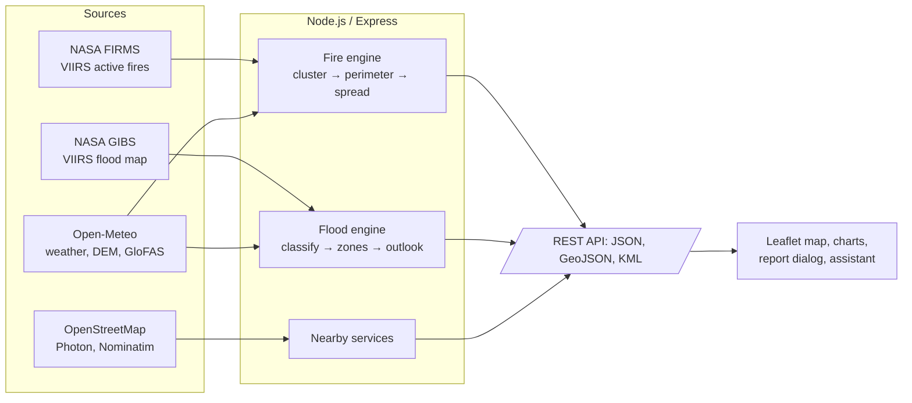

# DisasterGuardian

**Near-real-time wildfire and flood perimeters, 12-hour spread forecasts and field-ready reports for every Indian state and union territory.**

DisasterGuardian turns free NASA satellite streams into lightweight, actionable intelligence for first responders. It finds active fires and flood zones, draws their exact outlines, fuses them with live weather and terrain to forecast how they will spread over the next 12 hours, and compresses the result into a few kilobytes of GeoJSON/KML that work in the field.

---

## The problem

During a rapid-onset disaster, field teams cannot wait for manual analyst reports or download multi-gigabyte satellite scenes. They need to know **where the hazard is right now**, **where it is heading in the next 6–12 hours**, and **who to call** — on a phone, over a weak connection.

## What DisasterGuardian does

| | |
|---|---|
| **Disaster Map** | Live wildfire perimeters (NASA FIRMS VIIRS) with +1 / 3 / 6 / 12 h spread bands and a time slider, plus flood zones from the NASA VIIRS flood map with a 12-hour outlook. Works for all 28 states and 8 union territories. |
| **Report an incident** | One click on any fire or flood shows its district and state, the nearest fire stations and hospitals (distance, phone where available, directions), one-tap calls to 112 / 101 / 108, and a ready-to-send report with exact coordinates. |
| **Field exports** | Fires as GeoJSON and KML, floods as GeoJSON — open directly in Google Earth, QGIS or offline phone map apps. |
| **Analytics** | Hourly temperature, rain probability and wind charts for every state capital. |
| **Disaster Assistant** | 56 vetted preparedness questions across 13 topics (floods, wildfires, earthquakes, cyclones, heatwaves, lightning, first aid…) answered instantly, plus an AI chat (Groq) for anything else. |
| **Home** | A realistic, interactive 3D Earth (Three.js) with day/night lighting, clouds and atmosphere. |

## How it meets the evaluation criteria

### 1. Boundary extraction accuracy

**Wildfires** — VIIRS 375 m active-fire detections from three satellites (Suomi NPP, NOAA-20, NOAA-21):

1. Filter by detection confidence.
2. Cluster detections with DBSCAN (1.5 km radius) into separate incidents.
3. Draw a concave hull around each cluster and buffer it by half the *actual* pixel footprint (VIIRS pixels grow towards the scan edge, so the scan × track size of each detection is used instead of a fixed 375 m).
4. Union with every buffered pixel so no detection falls outside its perimeter. The share of detections inside each perimeter is reported (currently 100%).

**Floods** — the NASA VIIRS Combined Flood product (2-day composite, ~375 m):

1. Download the classified flood raster for the state from NASA GIBS and read each pixel's class back exactly from the product's published colour map (flood, recurring flood, surface water, cloud/no data).
2. Group flood pixels into zones (8-connected, joining fragments within 2 pixels; zones under 3 pixels are discarded as noise).
3. Outline each zone with a concave hull of its edge pixels, buffered by half a pixel.
4. Measure area from the pixel count itself (not the simplified polygon), and report how much of the area was **hidden by cloud**, so users know where floods could not be seen.

### 2. Multi-variable spread forecasting

**Wildfire spread** (12 hours, hourly steps) — every vertex of the perimeter emits an elliptical Huygens wavelet each hour, and the new fire front is the envelope of those wavelets (Richards' method, as used in FARSITE). Rate of spread combines:

| Factor | Model |
|---|---|
| Wind speed and direction | Canadian Fire Behaviour Prediction (FBP) wind function, `exp(0.05039·U)`, hourly from Open-Meteo |
| Fire shape | FBP length-to-breadth ratio, `1 + 8.729·(1 − exp(−0.030·U))^2.155` |
| Slope | Copernicus DEM elevation stencil; slope converted to an equivalent wind (spread doubles per ~10° upslope, McArthur) and added to the wind vector |
| Relative humidity | `exp(−0.03·(RH − 40))`, clamped 0.25–2.5 |
| Fire intensity | Fire radiative power (FRP) of the detections, `√(meanFRP / 10)`, clamped 0.6–2.0 |

The result is a set of isochrone polygons for +1, +3, +6 and +12 h, plus the head-fire direction and speed for each incident.

**Flood outlook** (12 hours) — each flood zone is classed **Rising**, **Stable** or **Receding** from the forecast rainfall over the next 12 hours (Open-Meteo) and the 24-hour trend in modelled river discharge (GloFAS, via the Open-Meteo Flood API).

### 3. Data pipeline efficiency

- **Raw stream in, kilobytes out.** Example run (11 Oct 2026, north-east India): 69 fire detections → 44 incidents with perimeters and 12-hour forecasts in **288 ms**, a 172 KB unoptimised result reduced to **64 KB (10.5 KB gzipped)**. Floods for Assam: a 1409 × 860 px satellite raster → 30 flood zones and outlooks in **3.6 s**, delivered as **3 KB gzipped**.
- **Compact geometry:** polygons are simplified (~25 m tolerance, well under one pixel), coordinates quantised to 5 decimals (~1 m), and duplicate vertices removed.
- **Caching:** FIRMS and weather responses are cached for 10 minutes, flood rasters for 30 minutes and service lookups for 24 hours.
- **Batched requests:** weather, terrain, rainfall and river-flow inputs for all incidents in a state are fetched in a few multi-location calls, not one call per incident.
- **Transparent stats:** the map shows payload size, gzip size, vertices kept and per-stage latency for every run.

## Architecture



## Getting started

Requirements: **Node.js 18 or newer**.

```bash
git clone https://github.com/Sushant-deotalu/codechaat.git
cd codechaat
npm install
cp .env.example .env    # then add your keys (see below)
npm start
```

Open **http://localhost:3000**.

### Environment variables

| Variable | Needed for | Where to get it |
|---|---|---|
| `FIRMS_MAP_KEY` | Live wildfire detections | Free: https://firms.modaps.eosdis.nasa.gov/api/map_key/ |
| `GROQ_API_KEY` | AI chat for questions outside the 56 built-in ones | https://console.groq.com/keys |
| `GROQ_MODEL` | Optional, defaults to `llama-3.3-70b-versatile` | — |
| `DEEPSEEK_API_KEY` | Optional fallback AI provider | https://platform.deepseek.com |
| `PORT` | Optional, defaults to `3000` | — |

Without `FIRMS_MAP_KEY`, the wildfire layer runs in **replay mode** on the bundled sample. Flood detection, weather, nearby services and the 56 built-in assistant answers need no keys.

## API

All endpoints accept `state=<name>` (for example `state=Assam`) or an explicit `bbox=west,south,east,north`.

| Endpoint | Returns |
|---|---|
| `GET /api/states` | All states and union territories with capital, coordinates and bounding box |
| `GET /api/fires?state=&mode=auto\|live\|replay&days=1-5` | Fire incidents, perimeters, spread isochrones and pipeline stats |
| `GET /api/fires.geojson`, `/api/fires.kml` | The same, as field-ready downloads |
| `GET /api/floods?state=&date=YYYY-MM-DD` | Flood zones, perimeters, 12-hour outlooks and stats (default: latest complete day) |
| `GET /api/floods.geojson` | Flood zones as GeoJSON |
| `GET /api/nearby?lat=&lon=` | Location (district/state/country), nearest fire stations and hospitals, emergency numbers |
| `GET /api/weather?state=` | Hourly weather for the state capital |
| `POST /api/chat` | Assistant reply (`{ "message": "…" }`) |
| `GET /api/health` | Which data sources and AI provider are configured |

## Project structure

```
server.js               Express server and API routes
lib/
  firms.js              NASA FIRMS ingestion, CSV parsing, caching
  perimeter.js          DBSCAN clustering and fire perimeter extraction
  spread.js             Weather/terrain inputs and the Huygens spread model
  fire-engine.js        Fire pipeline orchestration, GeoJSON/KML export
  flood-engine.js       VIIRS flood raster → flood zones → outlook
  nearby.js             Nearest fire stations/hospitals and reverse geocoding
  india-states.js       States/UTs with capitals and bounding boxes
public/
  index.html, home.js   Home page and 3D Earth
  map.html, map-page.js, fire-intel.js, states.js
                        Disaster Map, incident list and report dialog
  analytics.html, analytics.js
  assistant.html, assistant.js, assistant-faq.js
  style.css
data/sample/            Replay dataset for offline demos
scripts/build-sample.js Rebuilds the replay dataset
```

## Limitations

DisasterGuardian is a prototype. Its outputs are satellite estimates, **not confirmed incidents or official forecasts**.

- **Satellite limits:** fires smaller than a pixel or under thick smoke or cloud can be missed, and hot industrial surfaces can trigger false fire detections. Floods under cloud cannot be seen, and cloud or terrain shadows can occasionally be classed as water.
- **State areas are rectangles,** so a state's view also includes border areas of neighbouring states and countries. The report dialog reverse-geocodes each incident to name its true district, state and country, and warns when it is outside India.
- **Spread forecasts are simplified models.** They use generic fuel behaviour (no fuel-type map), and the flood outlook is a qualitative trend, not an inundation forecast.
- **Fire station data is sparse.** OpenStreetMap lists relatively few Indian fire stations and phone numbers, so the report dialog always offers 101, 108 and 112 and a Google Maps search link as well.
- **The replay sample is synthetic:** its fire detections are generated in the exact FIRMS format, modelled on dry-season (March) hill-forest fires in south Assam, while its weather (ERA5) and elevation (Copernicus DEM) data are real.
- **Reporting is manual:** DisasterGuardian never contacts services itself. The user places the call or sends the message.

Always confirm with official sources: NDMA Sachet (sachet.ndma.gov.in), IMD (mausam.imd.gov.in) and your State Disaster Management Authority. **In an emergency, call 112.**

## Data sources and credits

- **NASA FIRMS** — VIIRS 375 m active fire data (Suomi NPP, NOAA-20, NOAA-21). We acknowledge the use of data and imagery from LANCE FIRMS, operated by NASA's Earth Science Data and Information System (ESDIS).
- **NASA GIBS** — VIIRS Combined Flood product (NASA LANCE NRT Global Flood Product).
- **Open-Meteo** — weather forecasts, ERA5 reanalysis, elevation (Copernicus DEM) and river discharge (GloFAS), licensed CC BY 4.0.
- **OpenStreetMap contributors** — base map tiles and fire station/hospital locations (ODbL), searched through **Photon** (Komoot) and **Nominatim**.
- **Libraries:** Express, Turf.js, pngjs, Leaflet, Chart.js, Three.js; Earth textures from the Three.js examples.
- used ai for source code
